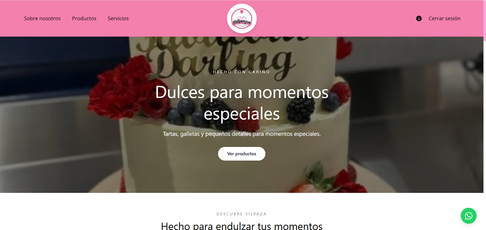

# 🧁 Silpaza — Pastelería online

Frontend de una tienda de repostería artesanal construido con **React 19**, **Vite 7** y **Tailwind CSS 4**. Incluye catálogo por categorías, ficha detallada de producto con alérgenos, registro e inicio de sesión, área de perfil protegida y una interfaz totalmente responsive.

> 🔗 **Demo en vivo:** _[añade aquí la URL de Vercel/Netlify]_
> 🎬 **Vídeo de demostración:** _[añade aquí el enlace a YouTube/Vimeo]_



> [!NOTE]
> Este es un proyecto **solo frontend**, creado con fines de aprendizaje y portfolio. El catálogo vive en un archivo local y la autenticación está **simulada** con `localStorage`. Consulta [Limitaciones conocidas](#-limitaciones-conocidas).

---

## 📑 Índice

1. [Funcionalidades](#-funcionalidades)
2. [Stack tecnológico](#-stack-tecnológico)
3. [Empezar](#-empezar)
4. [Scripts disponibles](#-scripts-disponibles)
5. [Estructura del proyecto](#-estructura-del-proyecto)
6. [Arquitectura](#-arquitectura)
7. [Modelo de datos](#-modelo-de-datos)
8. [Autenticación y sesión](#-autenticación-y-sesión)
9. [Rutas](#-rutas)
10. [Estilos y diseño](#-estilos-y-diseño)
11. [Accesibilidad y SEO](#-accesibilidad-y-seo)
12. [Limitaciones conocidas](#-limitaciones-conocidas)
13. [Roadmap](#-roadmap)
14. [Despliegue](#-despliegue)
15. [Autoría](#-autoría)

---

## ✨ Funcionalidades

- **Página de inicio** con hero, servicios, collage de productos, producto destacado, llamada a la acción e historia de la marca.
- **Catálogo** organizado por categorías (pasteles, galletas y panes).
- **Ficha de producto** con descripción, características y **alérgenos** con iconos.
- **Registro e inicio de sesión** con validación de formularios (email, contraseña, confirmación, teléfono por país) y foto de perfil opcional.
- **Sesión persistente**: el usuario sigue identificado al recargar la página.
- **Ruta protegida** (`/perfil`): redirige a `/login` si no hay sesión.
- **Botón flotante de WhatsApp** y llamada directa para hacer pedidos.
- **Contenido multimedia**: reproductor de audio y de vídeo.
- **Página 404** personalizada.
- **Diseño responsive** (móvil, tablet y escritorio).

## 🛠 Stack tecnológico

| Tecnología | Versión | Uso |
|:--|:--|:--|
| [React](https://react.dev) | 19 | Interfaz de usuario |
| [Vite](https://vite.dev) | 7 | Entorno de desarrollo y build |
| [React Router](https://reactrouter.com) | 7 | Enrutado y rutas protegidas |
| [Tailwind CSS](https://tailwindcss.com) | 4 | Estilos utilitarios (vía `@tailwindcss/vite`) |
| [Sass](https://sass-lang.com) | 1.x | Estilos específicos (`.scss`) |
| [React Icons](https://react-icons.github.io/react-icons/) | 5 | Iconografía |
| [ESLint](https://eslint.org) | 9 | Calidad del código |

## 🚀 Empezar

**Requisitos:** Node.js 20 o superior y npm.

```bash
# 1. Clona el repositorio
git clone https://github.com/<tu-usuario>/Silpaza.git
cd Silpaza

# 2. Instala las dependencias
npm install

# 3. Arranca el servidor de desarrollo
npm run dev
```

Abre en el navegador la URL que muestre Vite (normalmente `http://localhost:5173`).

## 📜 Scripts disponibles

| Comando | Descripción |
|:--|:--|
| `npm run dev` | Servidor de desarrollo con recarga en caliente |
| `npm run build` | Genera la versión de producción en `dist/` |
| `npm run preview` | Sirve localmente el build de producción |
| `npm run lint` | Revisa el código con ESLint |

## 🗂 Estructura del proyecto

```text
.
├── public/                  # Archivos estáticos (robots.txt, sitemap.xml)
├── src/
│   ├── assets/
│   │   ├── audio/
│   │   ├── img/             # Imágenes en formato WebP
│   │   └── video/
│   ├── components/          # Componentes reutilizables
│   │   ├── Header.jsx
│   │   ├── Footer.jsx
│   │   ├── Banner.jsx
│   │   ├── Servicios.jsx
│   │   ├── ImagenCollage.jsx
│   │   ├── Destacarproducto.jsx
│   │   ├── ProductoItem.jsx
│   │   ├── Alergenos.jsx
│   │   ├── ContactForm.jsx
│   │   ├── FormField.jsx
│   │   ├── InputContrasenya.jsx
│   │   ├── ProtectedRoute.jsx
│   │   └── ...
│   ├── context/
│   │   └── AuthContext.jsx  # Estado global de sesión
│   ├── data/
│   │   └── productosData.js # Catálogo (datos locales)
│   ├── pages/               # Una por ruta
│   │   ├── Home.jsx
│   │   ├── Productos.jsx
│   │   ├── DetalleProducto.jsx
│   │   ├── Servicios.jsx
│   │   ├── SobreNosotros.jsx
│   │   ├── Login.jsx
│   │   ├── Register.jsx
│   │   ├── Perfil.jsx
│   │   └── PaginaError.jsx
│   ├── styles/              # Estilos Sass
│   ├── App.jsx              # Definición de rutas
│   ├── main.jsx             # Punto de entrada
│   └── index.css            # Tailwind + tema (@theme)
├── index.html
├── vite.config.js
└── package.json
```

## 🏗 Arquitectura

```text
main.jsx
  └─ App.jsx
       └─ <AuthProvider>              ← estado de sesión disponible en toda la app
            └─ <Router>
                 ├─ Rutas públicas    (Home, Productos, Detalle, Login...)
                 └─ <ProtectedRoute>  ← exige sesión
                      └─ Perfil
```

Principios que sigue el proyecto:

1. **Una página por ruta** en `src/pages`, que compone componentes reutilizables.
2. **Estado global mínimo**: solo la sesión, mediante Context API (`useAuth()`).
3. **Datos separados de la interfaz**: el catálogo está en `src/data`, de modo que sustituirlo por una API solo afectaría a ese punto.
4. **Componentes de formulario reutilizables** (`FormField`, `InputContrasenya`) para evitar repetición.

## 🧩 Modelo de datos

El catálogo es un array `categorias`; cada categoría contiene sus productos.

**Categoría**

| Campo | Descripción |
|:--|:--|
| `id` | Identificador único |
| `nombre` | Nombre de la categoría |
| `descripcion` | Texto descriptivo |
| `color` | Color de la tarjeta |
| `icono` | Componente de icono (React Icons) |
| `productos` | Lista de productos |

**Producto**

| Campo | Descripción |
|:--|:--|
| `id` | Identificador único (global, usado en la URL) |
| `image` | Imagen importada |
| `nombre` | Nombre del producto |
| `descripcion` | Descripción corta (listado) |
| `descripcionLarga` | Descripción completa (ficha) |
| `caracteristicas` | Lista de características |
| `alergenos` | Lista de alérgenos (`gluten`, `lacteos`, `soja`...) |

```js
export const categorias = [
  {
    id: 1,
    nombre: "Pasteles",
    descripcion: "Tartas y bizcochos elaborados para tus celebraciones.",
    productos: [
      {
        id: 1,
        nombre: "Tarta de Chocolate",
        descripcion: "...",
        descripcionLarga: "...",
        caracteristicas: ["..."],
        alergenos: ["gluten", "lacteos", "soja"],
      },
    ],
  },
];
```

> [!TIP]
> Al ser objetos y arrays de JavaScript, migrar a una API REST, Supabase, Firebase o una base de datos SQL/NoSQL solo requiere cambiar el origen de los datos.

## 🔐 Autenticación y sesión

La autenticación está **simulada en el navegador**:

| Clave de `localStorage` | Contenido |
|:--|:--|
| `users` | Lista de usuarios registrados |
| `userData` | Usuario con la sesión activa (sin contraseña) |

Flujo:

1. **Registro**: se valida el formulario, se comprueba que el email no exista y se guarda el usuario en `users`. Después se inicia sesión automáticamente.
2. **Login**: se busca un usuario que coincida con email y contraseña en `users`.
3. **Sesión**: `AuthContext` expone `user`, `login()` y `logout()`. Al guardar la sesión se **elimina la contraseña** del objeto.
4. **Persistencia**: `AuthContext` lee `userData` al arrancar, así que la sesión sobrevive a recargas.
5. **Protección**: `ProtectedRoute` renderiza la ruta hija si hay usuario; si no, redirige a `/login`.

> [!WARNING]
> Las contraseñas de los usuarios registrados se almacenan **en texto plano** en `localStorage`, accesible desde las herramientas del navegador. Es válido para una demo, **nunca** para producción. **No introduzcas datos ni contraseñas reales.**

## 🧭 Rutas

| Ruta | Acceso | Descripción |
|:--|:--|:--|
| `/` | Pública | Redirige a `/home` |
| `/home` | Pública | Página principal |
| `/productos` | Pública | Catálogo completo por categorías |
| `/detalleProducto/:id` | Pública | Ficha de un producto |
| `/servicios` | Pública | Servicios y contacto |
| `/sobrenosotros` | Pública | Historia de la marca |
| `/login` | Pública | Inicio de sesión |
| `/register` | Pública | Creación de cuenta |
| `/perfil` | 🔒 Protegida | Datos del usuario y cierre de sesión |
| `*` | Pública | Página de error 404 |

## 🎨 Estilos y diseño

- **Tailwind CSS 4** para la mayoría de estilos. La configuración se hace en `src/index.css` con la directiva `@theme` (no hay `tailwind.config.js`).
- **Tipografías** de Google Fonts: _Leckerli One_ y _Pattaya_ para títulos, _Open Sans_ para el texto.
- **Sass** para estilos específicos de producto y footer, con variables en `_variables.scss`.
- **Paleta**: tonos crema (`#FDFAF3`, `#FAEDCD`) y granates (`#A4133C`, `#AE043D`).
- **Imágenes** optimizadas en WebP.

## ♿ Accesibilidad y SEO

- `lang="es"` en el documento y `meta description`.
- Un `h1` por página (oculto visualmente en Home y Login).
- Iconos decorativos con `aria-hidden` y botones con `aria-label` (por ejemplo, mostrar/ocultar contraseña).
- Etiquetas `label` asociadas a los campos de los formularios.
- `robots.txt` y `sitemap.xml` incluidos en `public/`.

## ⚠️ Limitaciones conocidas

- **Sin backend**: no hay base de datos ni API; el catálogo es una constante en el frontend.
- **Autenticación no segura**: ver el aviso en [Autenticación y sesión](#-autenticación-y-sesión).
- **Sin carrito ni pasarela de pago**: los pedidos se hacen por teléfono o WhatsApp.
- **Formulario de contacto de demostración**: no envía los datos a ningún servicio.
- **Sin tests automatizados**.
- **Catálogo reducido** (3 categorías y 8 productos).

## 🗺 Roadmap

- [ ] Desplegar la demo y enlazarla en este README
- [ ] Carrito de la compra (Context + `localStorage`)
- [ ] Conectar un backend real (Supabase / Firebase / API propia)
- [ ] Autenticación segura (JWT o sesiones, contraseñas con hash)
- [ ] Panel de administración de productos
- [ ] Buscador y filtros por categoría o alérgeno
- [ ] Envío real del formulario de contacto (Formspree / EmailJS)
- [ ] Tests con Vitest y React Testing Library
- [ ] Página por categoría y paginación / "Ver más"
- [ ] Optimizar el peso de los vídeos (alojarlos fuera del repositorio)

## ☁️ Despliegue

Al ser una SPA con React Router, el hosting debe redirigir todas las rutas a `index.html`.

**Vercel / Netlify**

1. Importa el repositorio.
2. Build command: `npm run build`
3. Output directory: `dist`
4. **Vercel**: añade un `vercel.json` en la raíz del proyecto con:
   ```json
   { "rewrites": [{ "source": "/(.*)", "destination": "/index.html" }] }
   ```
5. **Netlify**: añade un archivo `public/_redirects` con `/* /index.html 200`.

> [!IMPORTANT]
> Los nombres de archivo distinguen mayúsculas y minúsculas en servidores Linux. Un import como `../components/Header` solo funciona si el archivo se llama exactamente `Header.jsx`.

## 👩‍💻 Autoría
 
Proyecto creado por **Scarlett Toala**.
 
- 💼 LinkedIn: _[Scarlett Toala](https://www.linkedin.com/in/scarletttoala/)_
- 🐙 GitHub: _[Scarlett Toala](https://github.com/ScarlettToala)_
- ✉️ Contacto: _[sctoala@gmail.com](mailto:sctoala@gmail.com)_
 